<p align="center">
  
</p>

<h1 align="center">Mizan</h1>

<p align="center"><b>Restoran Yönetim Sistemi</b></p>

<p align="center">
  QR menüden mutfağa, kasadan stoğa restoranın tüm işleyişini tek yerden yönetin.<br />
  Rol ve izin bazlı yetkilendirmeyle her personel <b>yalnızca kendi işini</b> görür.
</p>

<p align="center">
  
  
  
  
  
  
  
  <a href="https://github.com/users/YunusEmr044/packages/container/package/mizan"></a>
</p>

---

## Ekran Görüntüleri

<table>
  <tr>
    <td width="50%">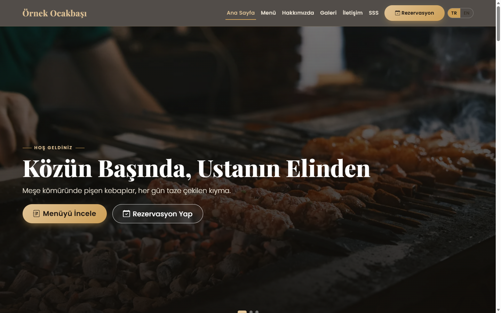<br /><sub><b>Restoran sitesi</b> — panelden düzenlenen kapak, menü, galeri ve rezervasyon</sub></td>
    <td width="50%">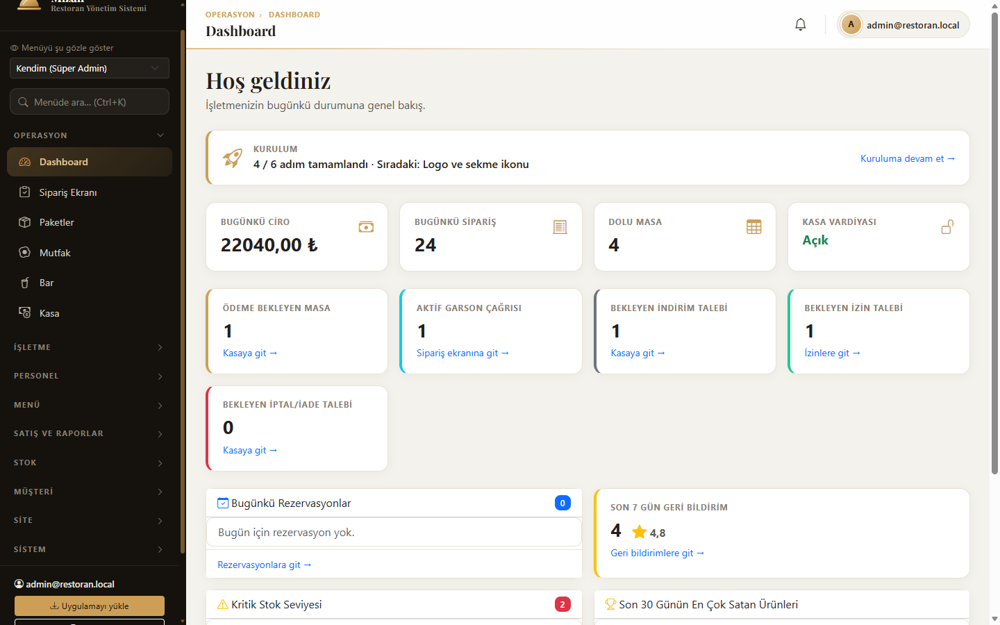<br /><sub><b>Dashboard</b> — günün durumu, bekleyen talepler, kritik stok, en çok satanlar</sub></td>
  </tr>
  <tr>
    <td>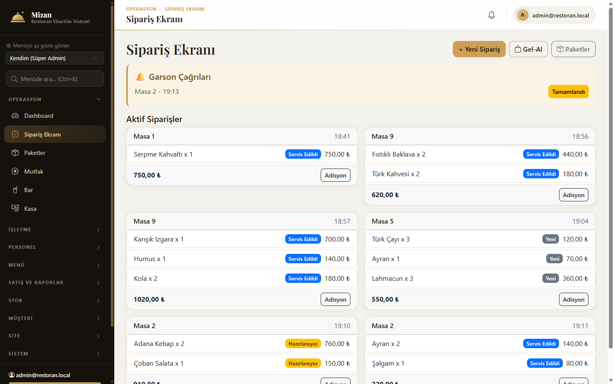<br /><sub><b>Garson ekranı</b> — masa bazlı aktif siparişler ve garson çağrıları</sub></td>
    <td>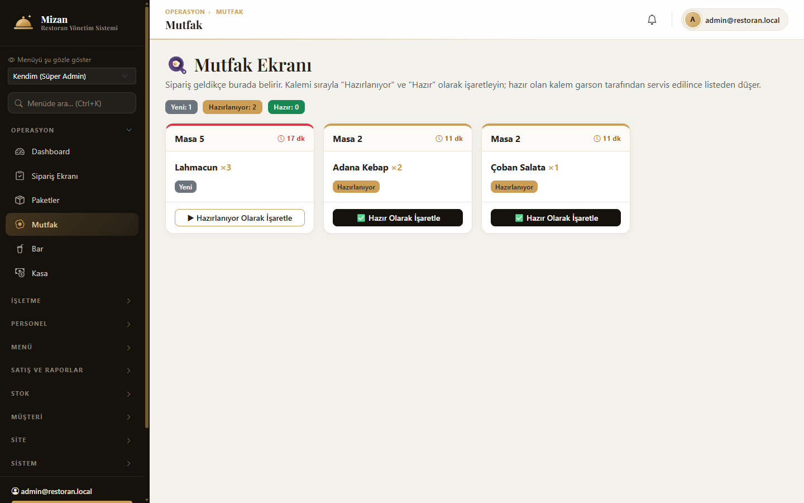<br /><sub><b>Mutfak ekranı</b> — siparişler bölüme göre düşer, bekleme süresi görünür</sub></td>
  </tr>
  <tr>
    <td>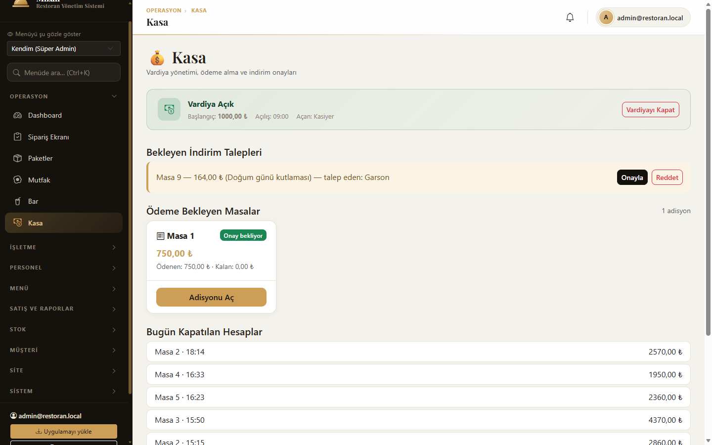<br /><sub><b>Kasa</b> — vardiya, ödeme alma, indirim onayları</sub></td>
    <td>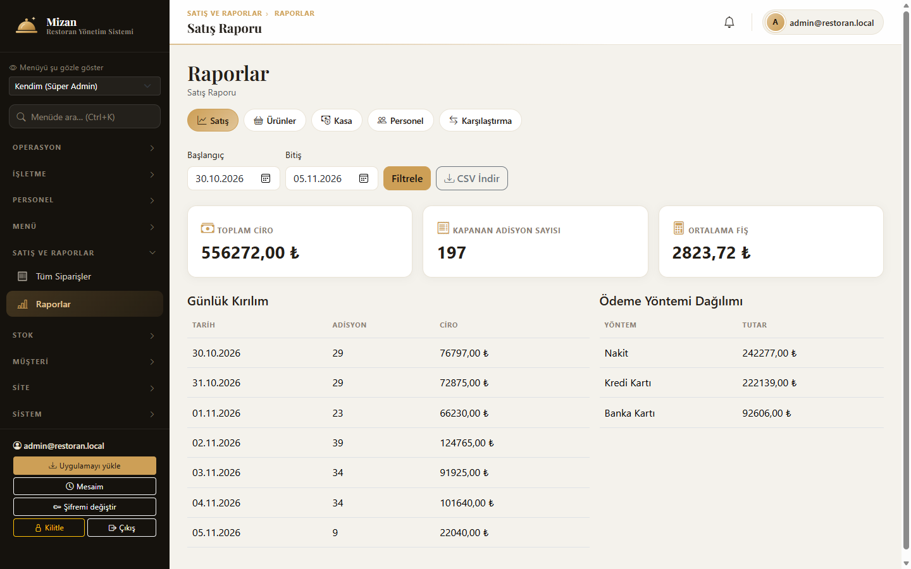<br /><sub><b>Raporlar</b> — günlük ciro, ödeme yöntemi dağılımı, CSV dışa aktarma</sub></td>
  </tr>
  <tr>
    <td>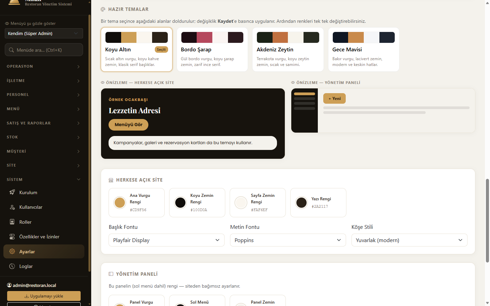<br /><sub><b>Görünüm ayarları</b> — hazır temalar, renkler ve yazı tipleri</sub></td>
    <td align="center">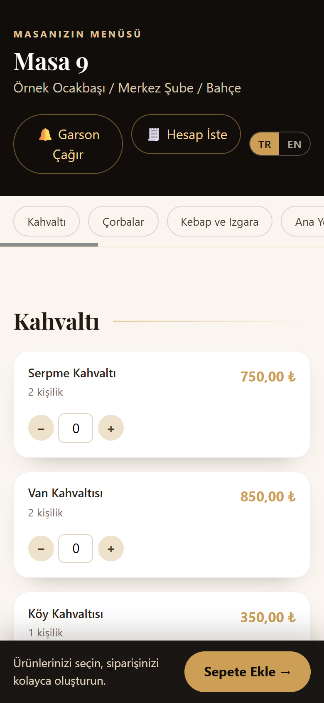<br /><sub><b>QR menü</b> — masaya özel menüden sipariş, garson çağırma, hesap isteme</sub></td>
  </tr>
  <tr>
    <td>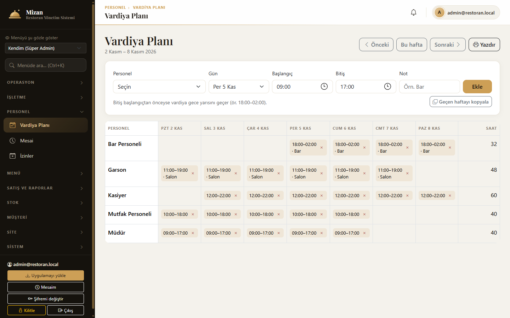<br /><sub><b>Personel</b> — haftalık vardiya planı, mesai ve izinler</sub></td>
    <td>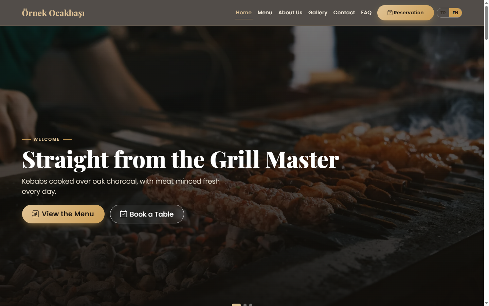<br /><sub><b>İngilizce site</b> — /en altında menü, QR menü ve yasal sayfalar dahil</sub></td>
  </tr>
</table>

## Özellikler

**Müşteri tarafı**
- Masaya özel QR menü: ürün seçenekleriyle sipariş, sepet, garson çağırma, hesap isteme
- Türkçe ve İngilizce müşteri sitesi: İngilizce sayfalar `/en` önekiyle açılır (`/en/menu`, QR menü dahil); dil seçici, `hreflang` ve iki dilli site haritası. Menü ve site içeriğinin İngilizcesi panelden girilir, çevirisi olmayan metin Türkçe görünür
- Yönetim panelinden düzenlenen restoran sitesi: ana sayfa bölümleri, menü, galeri, rezervasyon, SSS, iletişim, müşteri değerlendirmeleri
- Mobilde sabit rezervasyon çubuğu; harita ziyaretçi istediğinde yüklenir
- Yasal sayfalar: KVKK aydınlatma metni, gizlilik, çerez politikası, kullanım koşulları (hazır şablonlarla, panelden düzenlenir)
- Çerez onayı; analitik (Google Analytics 4, Plausible, Umami) yalnızca onay sonrası yüklenir
- SEO: sayfa bazlı meta etiketleri, `sitemap.xml`, `robots.txt`, `llms.txt`, JSON-LD yapısal veri, paylaşım önizlemesi görseli

**Operasyon**
- Garson sipariş ekranı ve adisyon; indirim talebi ve yönetici onayı
- Masa taşıma, masa birleştirme ve ürün aktarma (kısmi adet dahil); eşzamanlı işlemlere karşı masa kilidi
- Gel-al ve adrese teslim paket siparişleri: müşteri bilgisi, söz verilen saat, kurye, teslim adımları; her biri panelden açılıp kapanan modül (adrese teslim varsayılan kapalı)
- Masada oturan müşteri için kalem bazında "paket" işareti; mutfak ekranında ve adisyonda görünür
- Kalem iptali, ödeme iptali ve iade talepleri: yönetici onayıyla, kasaya ters kayıt olarak işlenir
- Mutfak ve bar ekranları: siparişler bölüme göre ayrılır, bekleme süresi renkle uyarır
- Kasa: ödeme alma, kısmi ödeme, nakitte para üstü hesabı, vardiya açma/kapatma; hesabı ürün bazlı bölme (ödenen ürünler sonraki kişide görünmez, indirim oranla dağıtılır) ya da eşit bölme
- Adisyon çıktısı: 80 / 58 mm termal rulo, A5 ya da A4; yazı boyutu, gösterilecek bilgiler, vergi bilgisi ve alt bilgi panelden ayarlanır
- Yazar kasa (ÖKC) bağdaştırıcı altyapısı (modül, varsayılan kapalı): adisyon kapanınca şubenin cihazından tek mali fiş (kalemler, KDV, indirim, ödeme dağılımı); kartla ödeme cihaz destekliyorsa POS üzerinden. Bağdaştırıcı panelden seçilir; hazır gelenler Simülatör ve Elle. Kesilemeyen fişler kasada bekler, belirsiz sonuç otomatik tekrarlanmaz
- Mutfak yazıcısı (modül, varsayılan kapalı): sipariş ve iptal fişleri şube ve bölüme (mutfak/bar) göre ağ yazıcısına (ESC/POS, IP:9100) ya da tarayıcıdaki yazıcı istasyonuna otomatik gider; basılamayan fiş mutfak ekranında uyarı olarak görünür
- SignalR ile anlık bildirimler
- Personel uygulaması (PWA): garson tableti, mutfak/bar ekranı ve kasa ana ekrana "Mizan" olarak kurulur, tam ekran açılır; bağlantı koparsa uyarı sayfası gösterilir ve bağlantı gelince kendiliğinden yenilenir. Giriş gerektiren sayfalar cihaza kaydedilmez

**Yönetim**
- Çoklu restoran / şube / alan / masa yapısı
- Menüyü dosyadan aktarma: CSV şablonu (Excel), toplu ekleme ve fiyat güncelleme; hatalı satır varsa hiçbir şey kaydedilmez, hatalar satır numarasıyla listelenir
- Stok: malzemeler, reçeteler, siparişte otomatik stok düşümü ve iptalde iadesi, satın alma, tedarikçiler, kritik stok uyarısı
- Personel: haftalık vardiya planı (gece yarısını geçen vardiya, geçen haftayı kopyalama, yazdırma), personelin kendi hesabından işe başlama/çıkış ve dönemlik çalışma saati raporu, izin talebi ve yönetici onayı (onaylı izinler vardiya planında görünür)
- Müşteri kaydı ve sadakat seviyeleri, kampanyalar, rezervasyonlar
- Raporlar: satış (sipariş türüne göre kırılım dahil), ürün, kasa, personel performansı (garson ve kasiyer), önceki dönemle karşılaştırma (günlük ciro grafiği) ve kayıplar (iptal, indirim, iade, en sık nedenler); CSV dışa aktarma
- Kurulum sayfası: canlıya geçiş adımları (restoran adı, logo ve ikon, iletişim, masalar, menü, site adresi) otomatik işaretlenir; masalar tek adımda oluşturulabilir
- Rol ve izinlere göre kart gösteren dashboard (açık paketler, basılamayan mutfak fişleri, mali fiş bekleyen adisyonlar dahil); gruplu menü, menüde arama (`Ctrl+K`) ve breadcrumb
- Rol bazlı menü ve ekranlar: mutfak ve bar personeli yalnızca kendi ekranını görür; Süper Admin menüyü ve dashboard'u başka bir rolün gözüyle önizleyebilir
- Görünüm ayarları: dört hazır tema, site ve panel renkleri, yazı tipleri, köşe stili; okunabilirlik (kontrast) kontrolü
- Kullanıcı pasife alma, kullanıcının kendi şifresini değiştirmesi; SMTP ayarlıysa girişte "şifremi unuttum" (tek kullanımlık e-posta bağlantısı)
- E-posta (SMTP, panelden): rezervasyon onay/red e-postaları, şifre sıfırlama, deneme e-postası; SMTP şifresi şifreli saklanır
- Site adresi (QR kodlarının yönlendiği adres) panelden ayarlanır; bilgisayarın yerel ağ adresi otomatik önerilir

**Güvenlik ve altyapı**
- 10 hazır rol (Süper Admin, Restoran Sahibi, Müdür, Garson, Kasiyer, Mutfak, Bar, Depo, Muhasebe, Rapor Görüntüleyici) + panelden tanımlanan özel roller; izin bazlı yetkilendirme, modül aç/kapa
- İşlem kaydı (audit log), hatalı girişte hesap kilitleme, oturumu kilitleme
- IP bazlı hız sınırlama, güvenlik başlıkları (CSP, X-Frame-Options vb.)
- Yazı tipleri ve harita için ziyaretçi onayı olmadan Google'a istek gönderilmez
- Erişilebilirlik: klavye odak halkası, "hareketi azalt" tercihine uyum, JavaScript kapalıyken de görünen içerik
- Otomatik veritabanı yedekleme, `/health` sağlık kontrolü, Windows Service desteği

## Nasıl Çalışır

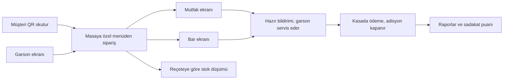

Sipariş masadan (QR) ya da garson ekranından verilir; yemekler mutfağa, içecekler bara ayrı düşer. Ürün hazır olduğunda garsona anlık bildirim gider. Ödeme kasada alınır, adisyon kapanır; satışlar raporlara, harcama müşterinin sadakat puanına yansır.

## Hızlı Başlangıç

**Gereksinimler:** [.NET 10 SDK](https://dotnet.microsoft.com/download) ve SQL Server (ücretsiz Express sürümü yeterli). Veritabanı ve tablolar ilk açılışta otomatik oluşturulur.

```bash
git clone https://github.com/YunusEmr044/Mizan-Restoran-Yonetim-Sistemi.git
cd Mizan-Restoran-Yonetim-Sistemi
```

Güvenlik gereği depoda bağlantı dizesi yoktur; uygulama bağlantı dizesi bulamazsa açılışta hata vererek durur. Proje kökünde `appsettings.Development.json` oluşturun (bu dosya `.gitignore`'dadır). Aşağıdaki örnek aynı bilgisayardaki `.\SQLEXPRESS` sunucusuna bağlanır; SQL Server'ınızın adı farklıysa `Server=` kısmını değiştirin:

```json
{
  "ConnectionStrings": {
    "DefaultConnection": "Server=.\\SQLEXPRESS;Database=RestoranYonetimDb;Trusted_Connection=True;TrustServerCertificate=True;MultipleActiveResultSets=true"
  }
}
```

```bash
dotnet run
```

Site `http://localhost:5080`, yönetim paneli `http://localhost:5080/admin` adresinde açılır.

Geliştirme ortamında boş bir veritabanı, kurgusal **Örnek Ocakbaşı** verisiyle doldurulur: fotoğraflı menü ve galeri, son 30 güne yayılmış adisyonlar ve kasa vardiyaları, açık masalar, müşteriler, rezervasyonlar, değerlendirmeler ve stok. Bu veri production'da hiç oluşturulmaz; panelden elle değiştirdiğiniz alanlara dokunulmaz. Fotoğrafların kaynakları [Görsel Kaynakları](docs/GORSEL-KAYNAKLARI.md) sayfasındadır.

<details>
<summary><b>Örnek hesaplar</b> (yalnızca geliştirme ortamında oluşturulur)</summary>

<br />

Geliştirme ortamında (`ASPNETCORE_ENVIRONMENT=Development`) her rol için bir örnek hesap otomatik oluşturulur. Şifreler `Data/DbSeeder.cs` içinde tanımlıdır; production'da bu hesaplar hiç oluşturulmaz.

| Rol | E-posta |
|---|---|
| Süper Admin | `admin@restoran.local` |
| Restoran Sahibi | `restoran-sahibi@restoran.local` |
| Müdür | `mudur@restoran.local` |
| Garson | `garson@restoran.local` |
| Kasiyer | `kasiyer@restoran.local` |
| Mutfak Personeli | `mutfak@restoran.local` |
| Bar Personeli | `bar@restoran.local` |
| Depo Personeli | `depo@restoran.local` |
| Muhasebe | `muhasebe@restoran.local` |
| Rapor Görüntüleyici | `rapor@restoran.local` |

Giriş sonrası herkes kendi rolünün ekranına yönlendirilir. Rollerin izinleri **Sistem → Özellikler ve İzinler**, yeni roller **Sistem → Roller** ekranından yönetilir.

</details>

### Docker ile kurulum

.NET ve SQL Server kurmadan, Windows'ta WSL + Docker Desktop ile ya da herhangi bir Linux sunucuda çalıştırılabilir. Hazır imaj GitHub'dadır: [`ghcr.io/yunusemr044/mizan`](https://github.com/users/YunusEmr044/packages/container/package/mizan); kaynak kodu derlemeye gerek yoktur.

```bash
git clone https://github.com/YunusEmr044/Mizan-Restoran-Yonetim-Sistemi.git
cd Mizan-Restoran-Yonetim-Sistemi/docker
cp .env.example .env        # DB_PASSWORD, ADMIN_EMAIL ve ADMIN_PASSWORD'ü doldurun
docker compose up -d        # http://localhost:5080
```

Uygulama ve SQL Server iki ayrı konteynerde çalışır; veritabanı, otomatik yedekler, yüklenen görseller ve şifreleme anahtarları Docker birimlerinde saklanır ve güncellemede kaybolmaz. WSL kurulumu, restoran ağından erişim, domain + HTTPS, yedekler ve güncelleme: [docker/README.md](docker/README.md).

### Testler

```bash
dotnet test tests/RestoranYonetim.Tests
```

xUnit testleri izin ve menü kurallarını, iptal/iade kurallarını, tema kontrast hesaplarını, SEO ve güvenlik politikası üreticilerini, görsel işlemeyi ve demo veri üretimini kapsar.

### Veritabanı değişiklikleri

Proje EF Core Migrations kullanır; bekleyen migration'lar uygulama açılışında otomatik uygulanır. Modelde değişiklik yaptığınızda:

```bash
dotnet ef migrations add DegisiklikAdi
dotnet ef database update
```

## Yayına Alma

Uygulama tek bir bilgisayarda (restorandaki bir PC ya da sunucu) çalışır; tabletler, mutfak ekranı ve müşteri telefonları tarayıcıdan bağlanır. Ayrıntılı kurulum rehberleri:

| Rehber | İçerik |
|---|---|
| [Yayına alma](docs/YAYINA-ALMA.md) | Tek dosya `.exe` ile tek bilgisayarda çalıştırma, tek tıkla başlatma, yerel ağdan erişim, Windows Service, domain + HTTPS ile VPS'te yayın, production ayarları |
| [Yedekleme ve şifreleme](docs/YEDEKLEME.md) | Otomatik veritabanı yedeği, elle yedek, SQL Server TDE |
| [Docker ile kurulum](docker/README.md) | Hazır imajla (WSL ya da Linux sunucu) tek komutla kurulum, domain + otomatik HTTPS, yedek ve güncelleme |

### Canlıya çıkmadan önce

- [ ] **Ortam:** Sunucuda `ASPNETCORE_ENVIRONMENT` tanımsız ya da `Production` olmalı; **asla `Development` olmamalı**. Development modunda kaynak kodda şifreleri açıkça yazılı örnek hesaplar oluşturulur ve bu hesaplarla herkes yönetici olarak girebilir.
- [ ] **Veritabanı:** Bağlantı dizesi `appsettings.Production.json` dosyasında ya da `ConnectionStrings__DefaultConnection` ortam değişkeninde. Uzak SQL Server'da `Encrypt=True` kullanın.
- [ ] **İlk yönetici:** `INITIAL_SUPERADMIN_EMAIL` ve `INITIAL_SUPERADMIN_PASSWORD` ortam değişkenleriyle, güçlü bir şifreyle oluşturun. İlk girişten sonra bu değişkenleri kaldırın.
- [ ] **HTTPS:** Domain ve sertifika varsa `RequireHttps` açık kalmalı (varsayılan; HTTPS yönlendirmesi ve HSTS). `AllowedHosts` değerini kendi domain'inizle sınırlayın.
- [ ] **Site adresi:** **Ayarlar → Site Adresi**'ne gerçek adresi girin; QR kodları bu adrese yönlenir.
- [ ] **Kurulum sayfası:** **Sistem → Kurulum** sayfası eksik adımları gösterir; hiç masa yoksa masaları tek adımda oluşturur. "Mizan" yazılımın adıdır; sitede restoranınızın adı, logosu ve sekme ikonu görünür.
- [ ] **Logo ve sekme ikonu:** Logoyu **Site İçeriği**'nden, sekme ikonunu **SEO Ayarları**'ndan yükleyin. Yüklenmezse sitede yalnızca restoran adı ve nötr bir ikon görünür.
- [ ] **İşletme bilgileri:** **Site İçeriği**'nde restoran adı, adres, telefon ve e-postayı doldurun. Yasal sayfalar bu bilgilerle doldurulur; boş alanlar metinde "—" olarak görünür.
- [ ] **Yasal metinler:** **Site → Yasal Sayfalar**'daki KVKK, gizlilik, çerez ve kullanım koşulları şablonlarını işletmenize göre gözden geçirin. Şablonlar hukuki danışmanlık yerine geçmez.
- [ ] **Restoran yapısı:** Restoran, şube, alan ve masaları oluşturup masaya özel QR kodlarını basın.
- [ ] **E-posta:** **Ayarlar → E-posta (SMTP)**'ye sağlayıcınızın SMTP bilgilerini girip deneme e-postası gönderin. Girilmezse rezervasyon e-postaları ve "şifremi unuttum" çalışmaz.
- [ ] **Yedek:** Otomatik yedeğin çalıştığını ve yedek klasörüne yazabildiğini doğrulayın.

Ayrıntılar [Yayına alma](docs/YAYINA-ALMA.md#5-production-ayarları) rehberindedir.

### Restoranın kendi cihazlarıyla yapacağı denemeler

Bu adımlar geliştirme sırasında gerçek cihaz ve uzman olmadan yapılamadı; açılıştan önce restoranda yapılmalıdır.

- [ ] **Mutfak yazıcısı:** Termal yazıcıyı **Yazıcılar** sayfasına ekleyip **Test fişi bas** düğmesine basın; Türkçe karakterlerin (ç, ğ, ı, ö, ş, ü) doğru çıktığını ve kağıdın kesildiğini kontrol edin. Ardından bir deneme siparişi gönderip fişin doğru yazıcıdan (mutfak/bar) çıktığına bakın. Ayrıntılar: [Mutfak yazıcısı kurulumu](#mutfak-yazıcısı-kurulumu).
- [ ] **Telefon ve tablet (PWA):** Garson telefonunda ve kasada siteye girip uygulamayı ana ekrana ekleyin (Android: menüdeki **Uygulamayı yükle**; iPhone: Safari → Paylaş → **Ana Ekrana Ekle**). Uygulamanın tam ekran açıldığını, Wi-Fi kapatılınca uyarı sayfasının çıktığını ve bağlantı gelince kendiliğinden yenilendiğini deneyin.
- [ ] **Yazar kasa (ÖKC):** Kullandığınız cihazın markası için bağdaştırıcı gerekir; hazır gelenler yalnızca Simülatör ve Elle moddur. Cihaz üreticisinin entegrasyon dokümanı alınıp bağdaştırıcı eklenene kadar **Elle** modu kullanın. Ayrıntılar: [Yazar kasa (ÖKC)](#yazar-kasa-ökc).
- [ ] **Mali müşavir:** Kategori/ürün KDV oranlarını, mali fişin adisyon kapanınca kesilmesini ve iade/iptal sürecini mali müşavirinize onaylatın.
- [ ] **Hukuk:** KVKK, gizlilik, çerez ve kullanım koşulları metinlerini ve **İngilizce taslaklarını** bir avukata kontrol ettirin (İngilizce metinler bilgilendirme amaçlıdır; geçerli olan Türkçe metindir).

### Sonraki sürüm (bu sürümde yok)

- SMS / WhatsApp bildirimleri (sağlayıcı ve ileti izni gerekir)
- e-Arşiv / e-Fatura (entegratör seçimi gerekir)
- QR menüden online ödeme (iyzico, PayTR vb.)
- Saatlik yoğunluk ısı haritası ve ürün kârlılık raporu
- Üçüncü dil (altyapı hazır; Arapça için sağdan sola düzen gerekir)
- Personel: maaş, bordro ve SGK işlemleri

### Yazar kasa (ÖKC)

1. **Özellikler ve İzinler**'den **Yazar Kasa (ÖKC)** modülünü açın; **İşletme → Yazar Kasa**'da şube için cihaz ekleyip bağdaştırıcıyı seçin ve **Bağlantıyı test et** ile deneyin.
2. **Menü → Kategoriler** ve ürün formlarında KDV oranlarını girin (varsayılan %10; ör. alkollü içecekler %20). Oranları ve fiş sürecini mali müşavirinizle teyit edin.
3. Adisyon onaylanınca fiş kesilir. Kesilemeyen fişler kasada **Mali fiş bekleyenler** bölümünde görünür: tekrar deneyin, cihazdaki fiş numarasını girin ya da gerekçeyle fişsiz kapatın. Cihaz yanıt vermezse (belirsiz) sistem otomatik denemez; önce cihazda fişin çıkıp çıkmadığını kontrol edin.
4. **Simülatör** yalnızca denemek içindir; kestiği fişler "SİMÜLATÖR" etiketiyle görünür. **Elle** bağdaştırıcısında fiş cihazdan kesilir, numarası kasada girilir.
5. USB/seri porttan bilgisayara bağlı cihazlarda Mizan aynı bilgisayarda ya da aynı yerel ağda çalışmalıdır.

**Yazar kasa bağdaştırıcısı ekleme (geliştirici):** `Services/Fiscal/IFiscalAdapter.cs` arayüzünü uygulayan bir sınıf yazın (`Key`, `DisplayName`, `Capabilities`, `SettingFields`, `TestAsync`, `PrintReceiptAsync`, `ChargeCardAsync`, `VoidReceiptAsync`) ve `Program.cs`'e `builder.Services.AddSingleton<IFiscalAdapter, YeniAdapter>();` ekleyin. Panel formu `SettingFields`'tan çizilir; `Secret` alanlar şifreli saklanır. Cihaz işlemi kesin reddettiyse `Hata`, yanıt alınamadıysa ya da bağlantı işlem ortasında koptuysa mutlaka `Belirsiz` döndürün — belirsiz sonuç ikinci bir mali fiş kesilmesini önlemek için otomatik tekrar edilmez. Üreticinin SDK'sı/API dokümanı ve test cihazı gerekir; örnek olarak `SimulatorFiscalAdapter`'a bakın.

### İngilizce içerik

1. **Site → Çeviriler** sayfasını açın. Sekmeler: Menü, Site metinleri, Ana sayfa, SSS, Kampanyalar, Galeri, Yasal sayfalar, SEO; her sekmede eksik çeviri sayısı görünür.
2. Solda Türkçe metin, sağda İngilizce kutusu vardır. Doldurup **Kaydet**'e basın; boş bırakılan alan İngilizce sitede Türkçe görünür. **Yalnızca eksikler** filtresi kalan işi gösterir.
3. Arayüz metinleri (düğmeler, başlıklar, form mesajları) `Resources/i18n/en.json` dosyasındadır. Müşteri sayfasına yeni bir metin eklenirse İngilizcesi de bu dosyaya yazılmalıdır; eksik kalırsa testler uyarır.
4. Personel paneli, mutfak fişi ve adisyon her zaman Türkçedir; İngilizce QR menüden verilen siparişte de ürün adı mutfağa Türkçe gider.
5. Varsayılan metinlerin (SSS, ana sayfa özellikleri ve istatistikleri) ve yasal sayfa şablonlarının İngilizcesi kurulumda otomatik eklenir; demo verisinde menünün tamamı da çevrilidir. Panelden değiştirdiğiniz Türkçe metnin İngilizcesini kendiniz girmelisiniz. **Yasal sayfaların İngilizcesi taslaktır**; yayından önce bir hukukçuya kontrol ettirin.
6. Masa adları "Masa 5" biçimindeyse İngilizce sayfada "Table 5" görünür; özel adlar (ör. "Bahçe 3") olduğu gibi kalır.
7. Kontrol: uygulama çalışırken `python Tools/check-english.py` İngilizce sayfalarda Türkçe kalan metni listeler (müşteri yorumları ve özel adlar hariç).

### Mutfak yazıcısı kurulumu

1. **Özellikler ve İzinler** sayfasından **Mutfak Yazıcısı** modülünü açın, ardından **İşletme → Yazıcılar**'da şube ve bölüm için yazıcı ekleyin. **Test fişi bas** ile deneyin.
2. **Ağ yazıcısı:** ESC/POS destekli termal yazıcıya sabit IP verin ve IP:port (genellikle 9100) girin. Sunucu yazıcıyla aynı yerel ağda olmalıdır; bulutta çalışan sunucu restorandaki yazıcıya ulaşamaz. Türkçe karakterler CP857 kod sayfasıyla gönderilir.
3. **Tarayıcı yazıcısı (USB yazıcılar için):** Mutfaktaki bilgisayarda yazıcıyı varsayılan yazıcı yapın ve istasyon sayfasını yazdırma penceresi açmadan basacak şekilde açın:

   ```bash
   msedge --kiosk-printing --app=https://alan-adiniz/Yazici/Istasyon/1
   ```

   Chrome için `chrome --kiosk-printing --app=...` aynı şekilde çalışır. İstasyon sayfasını yalnızca bir sekmede açık tutun.
4. Fişler kuyruğa alınmaz: yazıcı ya da istasyon o an kapalıysa fiş yeniden denenmez. Basılamayan fişler mutfak/bar ekranında ve bildirimlerde görünür; sipariş ekranda kalmaya devam eder.

## Teknik Detaylar

- **İzin sistemi:** Rollerin izinleri veritabanında tutulur ve her istekte önbellekli olarak kullanıcıya eklenir; panelden yapılan değişiklik anında geçerli olur. İzin tablosu okunamazsa hiçbir izin verilmez (fail-closed).
- **Eşzamanlılık:** Adisyon ve kasa vardiyasında iyimser kilitleme (`RowVersion`); stok düşümü ve sadakat puanı atomik güncellemeyle yapılır. Aynı masadan aynı anda gelen siparişler masa başına veritabanı kilidiyle tek adisyonda birleşir. Çift tıklamada ya da iki kasiyer aynı anda işlem yaptığında siparişin iki kez gönderilmesi veya ödemenin iki kez sayılması engellenir.
- **Performans:** Menü, site içeriği ve izinler önbellekte; aynı anda gelen istekler önbelleği tek seferde doldurur (cache stampede koruması). Yanıt sıkıştırma (Brotli/Gzip) ve yavaş sorgu loglama açık.
- **Güvenlik:** Hatalı girişte hesap kilitleme, giriş ve herkese açık formlarda IP bazlı, QR menü işlemlerinde IP + masa bazlı hız sınırlama (aynı Wi-Fi'daki masalar birbirini engellemez), CSRF koruması, güvenlik başlıkları, yüklenen görsellerde içerik doğrulaması, önemli işlemler için işlem kaydı.
- **İşletme:** Her isteğe `X-Correlation-ID`, `/health` sağlık kontrolü, periyodik otomatik veritabanı yedeği, ters proxy desteği ve Windows Service olarak çalışma.

## Proje Yapısı

| Klasör | İçerik |
|---|---|
| `Controllers/` | Herkese açık site, QR menü, sipariş, kasa, mutfak, bar ve yasal sayfalar |
| `Areas/Admin/` | Yönetim paneli |
| `Views/` | Razor görünümleri ve ortak bileşenler |
| `ViewComponents/` | Panel menüsü, çerez onayı ve yasal bağlantılar |
| `Models/` | Veritabanı varlıkları, view model'ler ve tema kataloğu |
| `Data/` | `ApplicationDbContext`, başlangıç verileri (`DbSeeder`), geliştirme demo verisi (`DemoDataPlan`, `DemoDataSeeder`) |
| `Migrations/` | EF Core şema geçmişi |
| `Services/` | İş mantığı, önbellekler, yedekleme, SEO ve yayın yardımcıları (`Services/Publishing/`) |
| `Security/` | Roller, izinler ve yetkilendirme altyapısı |
| `Extensions/` | Transaction, ondalık sayı bağlayıcı ve sorgu yardımcıları |
| `Hubs/` | SignalR bildirim hub'ı |
| `HealthChecks/` | Veritabanı sağlık kontrolü |
| `wwwroot/` | CSS, JavaScript, görseller; `wwwroot/demo/` demo fotoğrafları |
| `tests/` | xUnit test projesi |
| `docs/` | Kurulum ve yedekleme rehberleri, ekran görüntüleri, görsel kaynakları |
| `Tools/` | Yük testi script'i (`load-test.py`) |

## Yük Testi

```bash
pip install aiohttp
python Tools/load-test.py --base-url http://localhost:5080 --concurrency 30 --duration 30
```

Sonuçta görülen `429` yanıtları hız sınırlamanın çalıştığını gösterir; `500` veya bağlantı hataları gerçek bir soruna işaret eder. Tüm seçenekler script'in başındaki açıklamada anlatılmıştır.

Örnek ölçüm (Release derleme, 20 çekirdekli tek bilgisayar, SQL Server Express, demo veriyle; site, QR menü ve görsel karışık trafik):

| Eşzamanlı kullanıcı | İstek/sn | Hata | p95 yanıt | Bellek |
|---|---|---|---|---|
| 300 (gerçekçi bekleme süreli) | 482 | %0 | 16 ms | 241 MB |
| 1000 (gerçekçi bekleme süreli) | 1017 | %0 | 344 ms | 286 MB |
| 1000 (beklemesiz, 4 istemci) | 3182 | %0 | 375 ms | 477 MB |

Test istemcisi aynı bilgisayarda çalıştığından değerler sunucunun üst sınırı değil, alt tahminidir.

## Lisans

[MIT](LICENSE) lisansı ile dağıtılmaktadır.
